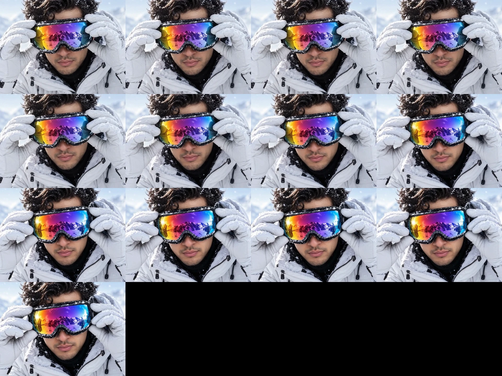
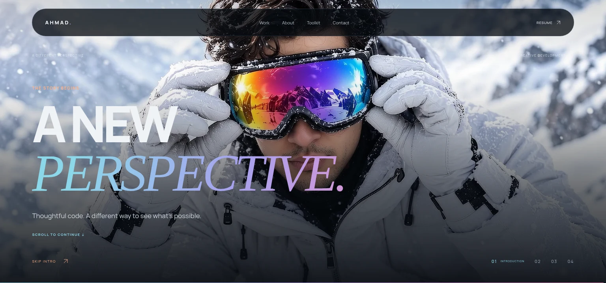
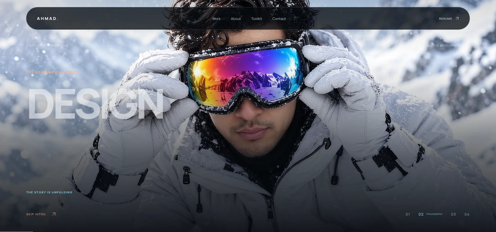

# Continuous intro motion

Film 01's original final pose differs from film 02's opening pose: the hands, head, and goggles move relative to one another. Changing only the image scale or position cannot align all of them. The playback edit completes that movement before the chapter boundary, so starting film 02 preserves the resting pose.

## Playback edit

`01-goggles-on-continuous.mp4` contains 77 frames at 24 fps:

- Frames 0–64 retain the original intro motion, with normal re-encoding differences.
- Frames 65–75 are eleven synthesized motion-interpolation frames between original frame 64 and the decoded frame at 1.5 seconds in `02-dissolve.mp4`.
- Frame 76 is that actual decoded opening image from film 02.

The movement occupies the final half second of the original frame sequence. There are no appended frames or endpoint holds. The reverse film is generated from this same playback edit. The encoded duration is 77/24 seconds (3.208 seconds); the original container reports 3.177 seconds because its final sample is shorter.

Motion interpolation uses [RIFE ncnn Vulkan](https://github.com/nihui/rife-ncnn-vulkan), release `20221029`, model `rife-v4.6`, at 1920 × 1080. The interpolation parameter follows `u²(3 − 2u)` to settle into the final pose. These eleven frames are reconstructed motion, not original captured frames. The three original forward MP4 files remain byte-identical; see [media hashes](qa/intro-matched/media-hashes.json).

The player uses the new asset names to avoid cached copies of the previous edit. It presents the matching incoming frame directly, using the existing loading hold and shared media plane. All chapters keep the same cover crop.

## Rebuild

Install FFmpeg and the RIFE executable/model from the release above, then run:

```sh
RIFE_BIN=/absolute/path/to/rife-ncnn-vulkan npm run media:intro
npm run qa:intro-motion
npm run build
```

`RIFE_MODEL` can override the default `rife-v4.6` directory beside the executable. The script uses CPU inference and checks the source footage hashes. Hosting builds use the committed MP4 assets and do not need these media tools.

## Executed verification

- `npm run qa:intro-motion`: both playback directions contain exactly 77 frames. The retained frames differ by at most 1.21/255 mean channel error. The final frame and reverse opening differ from film 02's actual start by 1.35/255 and 1.38/255 respectively. The reconstructed motion has no frozen frame or isolated large step. A best-fit opacity-blend comparison confirms that its intermediate geometry moves instead of merely blending the two poses.
- `npm run qa:intro`: all eight forward/reverse boundary comparisons pass at 1536 × 720, 390 × 844, 844 × 390, and reduced motion. The detected lens center and dimensions differ by at most **0.8 rendered pixels** at this boundary. The media element's size and position are unchanged. Compression leaves small color differences; decoded images are not byte-identical.
- `npm run qa:frames`: desktop, mobile, and fallback journeys pass through all three films forward and backward, gallery return, reset, delayed loading, and incoming start-frame exposure.
- All 20 controller/input tests, lint, TypeScript, production export, and hosting asset-size checks pass.

The recording covers all three films forward and backward. All thirteen frames spanning the repaired motion were also visually inspected, including a close crop of the hands and goggles.

[Browser recording](qa/intro-matched/preview.mp4) · [Motion measurements](qa/intro-matched/motion-report.json) · [Intro boundaries](qa/intro-matched/intro-handoff.json) · [Loading continuity](qa/intro-matched/frame-continuity.json)






Browser verification used Chromium with mobile viewport/touch emulation. Physical iPhone Safari was not tested. This fix is committed to the repair branch; main was not merged or deployed.
