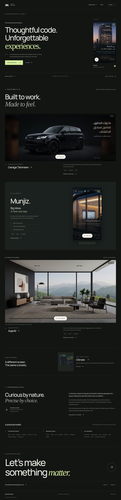
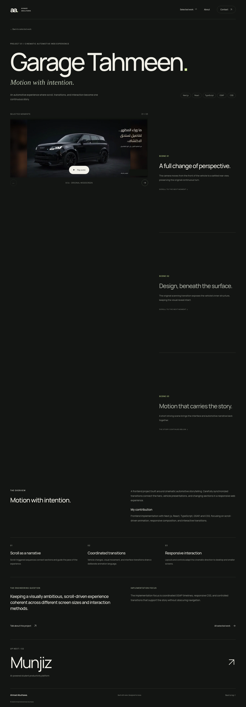
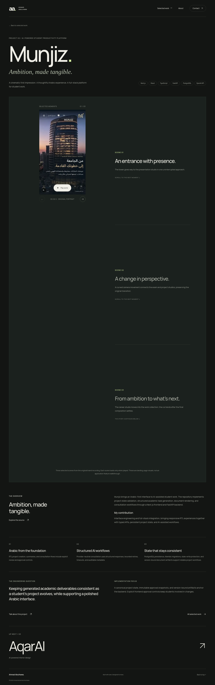
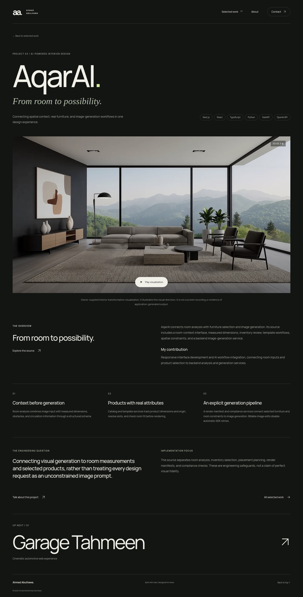
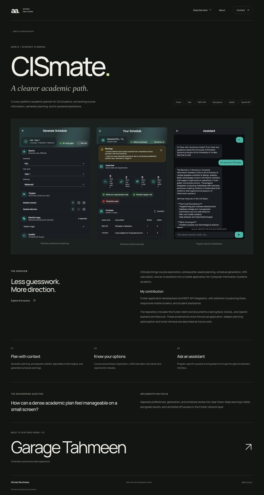

# Desktop visual approval — PR #1

Production static export inspected in real Chromium at **1440 × 1000 CSS pixels**, device scale 1. The five primary PNGs are full-page screenshots at their native 1440-pixel width. Desktop-only approval set, as requested. Nothing has been merged or deployed.

## Full-page screenshots

| Page           | Full-resolution PNG                                    |
| -------------- | ------------------------------------------------------ |
| Homepage       | [Open screenshot](screenshots/home-1440.png)           |
| Garage Tahmeen | [Open screenshot](screenshots/garage-tahmeen-1440.png) |
| Munjiz         | [Open screenshot](screenshots/munjiz-1440.png)         |
| AqarAI         | [Open screenshot](screenshots/aqar-ai-1440.png)        |
| CISmate        | [Open screenshot](screenshots/cismate-1440.png)        |

A full-page screenshot shows a sticky media stage only once. These additional viewport captures show the later real scenes and native player controls:

- Garage Tahmeen: [scene 2](screenshots/garage-tahmeen-scene-2-1440.png), [scene 3](screenshots/garage-tahmeen-scene-3-1440.png).
- Munjiz: [scene 2](screenshots/munjiz-scene-2-1440.png), [scene 3](screenshots/munjiz-scene-3-1440.png).

## Confirmed problems fixed

1. **Moving privacy-mask timing.** The recording's actual time base is 1/30017. Scheduling its moving masks against an assumed 30 fps left a small number of partially exposed frames during fast scrolling. Masks now follow each source frame's actual presentation timestamp, with a wider privacy envelope while the paragraph crosses the top boundary. No frames or scene duration have been cut.
2. **Stale scene after jumping to the top.** The previous intersection logic could retain the final scene when a scroll jump skipped the chapter's observation band. Selection now reads the viewport center in pixels through a passive scroll listener and a scheduled animation frame. Scene, counter, description and poster stay aligned.
3. **Tiny scene labels.** Desktop scene counters and duration labels increased to 10px; progression hints to 9px.
4. **Unnecessary player movement / recorded browser chrome.** Scene changes use a restrained opacity transition; the play target no longer translates. The captured browser scrollbar is masked in delivery encodes and posters, preserving the complete original aspect ratio.

## Verification

- All five pages load, render with a single h1, and have no horizontal overflow at 1440px.
- All lazy images and responsive poster variants load. No failed local asset requests or browser runtime errors.
- Observed CLS: **0 on all five pages**, including font loading and sequential page scrolling.
- No MP4 requests before explicit play, even while chapters change.
- All three Garage Tahmeen scenes and all three Munjiz scenes play with native controls and unchanged aspect ratios. Old sources unmount on scene change; previous/next and jump-to-top behavior are checked.
- Garage Tahmeen retains **256 / 249 / 129** source frames at the exact original 1912:824 ratio, delivered as 1434×618. Munjiz remains 464×848.
- Video dialogs play, close with Escape, release their source, and restore focus.
- Homepage project links, next-project navigation and back-to-work links function. Contact email, GitHub and LinkedIn destinations are validated against the supplied URLs. External services' uptime/login state is not asserted.
- Reduced-motion desktop behavior and keyboard controls remain available.
- axe WCAG A/AA audit: no reported violations on the five pages.
- **Media privacy:** all **634** native Garage delivery frames and all **six** full/small posters scanned with Arabic/English OCR: no client-name detections after correction. Separately, **920** visible mask regions across all frames passed opaque-coverage checks, and the critical scrolling transition was visually inspected at frame level. OCR is supporting evidence, not the only privacy check. See [privacy report](privacy-report.json).

## Privacy revision history

The earlier draft revision contained a small number of unmasked delivery frames. The corrected media replaces that revision in this assistant-authored draft branch's ordinary commit history. This verifies the current source tree and static export; a branch update cannot guarantee removal of GitHub's older cached/orphaned objects or outdated review references. Strict removal of any previously uploaded copies requires repository-owner/GitHub cleanup. No website deployment has occurred.

## Reproduce the desktop check

```sh
npm ci
npm run lint
npm run typecheck
npm run build
python -m http.server 3000 --directory out
```

In another terminal, use an installed Playwright Chromium (`npx playwright install chromium`) and run:

```sh
npm run qa:desktop
```

For an existing system Chromium, set `CHROMIUM_PATH` to its executable path. `PORTFOLIO_QA_URL` can select another local static server; default is `http://127.0.0.1:3000`. `PORTFOLIO_QA_OUTPUT` can select a scratch folder instead of replacing the review screenshots. Playwright is a development dependency and is not included in the website bundle. The browser check intentionally does not deploy anything.

## Homepage

[](screenshots/home-1440.png)

## Garage Tahmeen

[](screenshots/garage-tahmeen-1440.png)

## Munjiz

[](screenshots/munjiz-1440.png)

## AqarAI

[](screenshots/aqar-ai-1440.png)

## CISmate

[](screenshots/cismate-1440.png)
